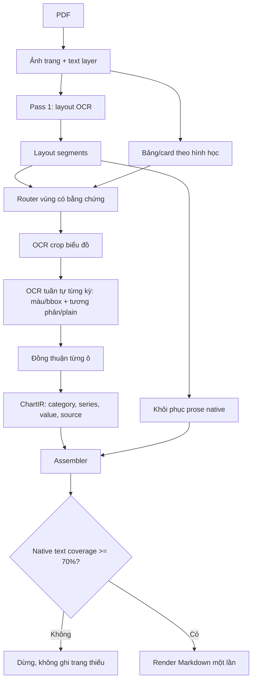

# Hướng dẫn chạy `pdf_to_md_vllm.py`

## Chế độ mặc định an toàn

```bash
python pdf_to_md_vllm.py --pdf input.pdf --output output.md
```

`--profile auto` dùng một pipeline chung cho mọi PDF, không phân nhánh theo tên
file, mã doanh nghiệp, số trang hoặc mẫu báo cáo:

1. Pass 1 đọc text, bảng, class và bbox với `predict_no_text_in_pic`.
2. Text layer, nếu có, chỉ sửa nguyên văn các vùng prose/heading trùng tọa độ;
   không dùng để tự dựng lại số liệu biểu đồ.
3. Những vùng `Chart` hoặc `Picture` có tín hiệu biểu đồ được đọc lại ở Pass 2.
4. Mặc định pipeline OCR toàn trang, sau đó phóng từng vùng biểu đồ trong bộ nhớ.
   Nếu lượt toàn vùng chưa đủ, từng kỳ được đọc **tuần tự** bằng hai view độc lập:
   ảnh màu với OCR có bbox và ảnh xám tăng tương phản với OCR thuần. Crop bỏ vùng
   tiêu đề và hạn chế chồng sang cột kế bên. Chỉ số khớp ở đúng kỳ giữa hai view
   mới vào bảng đồng thuận. Một lượt bbox đơn lẻ không bao giờ tự được đánh dấu
   `confirmed`.
5. Chỉ số thật sự được in trên biểu đồ mới được ghi. Điểm trên đường không có nhãn
   để đọc sẽ là `—`; pipeline không nội suy hoặc lấy số từ đoạn văn lân cận.
   Nếu không đủ bằng chứng, output vẫn giữ lượt chép trực tiếp tốt nhất dưới dạng
   bảng hoặc dữ liệu OCR thô và đánh dấu `uncertain`; code không tính, nội suy,
   xoay series hay lấy số từ đoạn văn/bảng khác để lấp chỗ trống.
   Output thô không bị loại chỉ vì model thiếu bbox/class hoặc chưa dựng được
   bảng. Với PDF có text layer, chữ và số đúng trong bbox biểu đồ cũng được giữ
   làm fallback để người dùng xem và sửa về sau.
6. Bảng PDF có text layer được dựng theo tọa độ cột, giữ nguyên ô trống và có thể
   hoàn thiện bảng bị OCR dừng giữa chừng. Bộ gom dừng trước tiêu đề biểu đồ.
   Trang chỉ có text bị cắt giữa chừng sẽ dùng toàn bộ text layer làm fallback.
   Trang có bảng/biểu đồ không bị fallback này ghi đè.

Pipeline không lưu và không nhúng ảnh biểu đồ. Việc phóng vùng chỉ diễn ra trong
bộ nhớ để OCR đọc được số nhỏ; mọi biểu đồ trong Markdown vẫn là dữ liệu văn bản
để có thể tìm kiếm, sao chép và xử lý tiếp.

## Kiến trúc xử lý



`ChartIR` giữ địa chỉ `(category, series)` và nguồn của từng giá trị. Hai lượt
OCR chỉ được coi là khớp khi các giá trị nằm đúng cùng địa chỉ, không phải chỉ
cùng xuất hiện đâu đó trong bảng. Nhãn OCR thô chỉ dùng để dựng/xác minh ChartIR,
không được tự chọn làm bảng output.

Output biểu đồ có provenance rõ ràng:

```markdown
<!-- chart_region source=pass1+pass2 status=confirmed -->
<!-- chart_region source=uncertain status=uncertain -->
```

Đầu file cũng ghi cấu hình chạy dưới dạng comment `ocr_run`, gồm profile yêu
cầu/profile hiệu lực, chart mode, mức zoom và trạng thái text layer. Vì vậy có
thể xác định chính xác pipeline đã tạo ra một file mà không cần nhớ lệnh shell.

## Hiệu năng

Mặc định `--workers 1` để ưu tiên độ ổn định. Có thể tăng khi vLLM đủ tài
nguyên và đã kiểm thử batching:

```bash
python pdf_to_md_vllm.py --pdf input.pdf --output output.md --workers 2
```

Lượt OCR vùng biểu đồ được bật mặc định. Có thể tắt nếu cần giảm thời gian xử lý;
khi đó biểu đồ raster nhỏ có thể không đọc được dữ liệu:

```bash
python pdf_to_md_vllm.py --pdf input.pdf --output output.md --no-chart-ocr-focus
```

Tăng độ phân giải OCR vùng khi nhãn nhỏ:

```bash
python pdf_to_md_vllm.py --pdf input.pdf --output output.md --chart-ocr-zoom 4.0
```

`--chart-confirmation single` chấp nhận một lượt OCR có bảng hợp lệ. Chỉ nên
dùng khi ưu tiên recall/tốc độ hơn độ chắc chắn:

```bash
python pdf_to_md_vllm.py --pdf input.pdf --output output.md \
  --chart-confirmation single
```

## Kiểm tra và debug

Lưu response thô của từng pass:

```bash
python pdf_to_md_vllm.py --pdf input.pdf --output output.md \
  --raw-output-dir debug_raw
```

Chạy một trang (số trang bắt đầu từ 1):

```bash
python pdf_to_md_vllm.py --pdf input.pdf --page 1 \
  --output page_1.md --raw-output-dir debug_raw
```

Tắt text layer để kiểm thử PDF scan:

```bash
python pdf_to_md_vllm.py --pdf input.pdf --output output.md --no-text-layer
```

## Profile

| Profile | Mục đích |
|:---|:---|
| `auto` | Pipeline hai lượt có điều kiện, khuyến nghị |
| `mixed` | Alias tương thích của `auto`; dùng `--chart-mode always` để ép Pass 2 |
| `text` | Một pass text/bảng |
| `chart` | Một pass `predict_text_in_pic` cho trang chuyên biểu đồ |
| `handwriting` | Một pass hình cho scan/form; phụ thuộc khả năng model |
| `ocr` | OCR thuần, không bbox/class |
| `plain` | Text thô |
| `fast` | Markdown nhanh, không bbox |

Điều khiển Pass 2:

```bash
python pdf_to_md_vllm.py --pdf input.pdf --output output.md --chart-mode always
python pdf_to_md_vllm.py --pdf input.pdf --output output.md --chart-mode never
```

`--postprocess-domain` chỉ còn để tương thích lệnh cũ. Các giá trị `auto`,
`generic`, `financial` đều không kích hoạt rule tài chính hoặc sinh thêm số.
